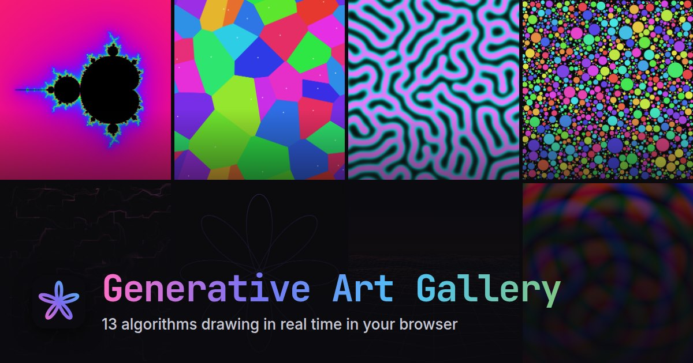

# Generative Art Gallery

[](https://aljazfrancic.github.io/generative-art-gallery/)

An interactive gallery of 13 generative art algorithms, drawn in real time in your browser with [p5.js](https://p5js.org/). Flow fields, fractals, cellular automata, reaction-diffusion and more: shape each one with live parameters, then save a PNG, record a video or share a link to exactly what you made.

**[Open the gallery →](https://aljazfrancic.github.io/generative-art-gallery/)**

## Features

- **13 algorithms**, all animated live (the Mandelbrot set is yours to explore instead)
- **Live parameters**: sliders, colors, toggles and menus apply as you change them
- **Randomize** for a surprise, **Defaults** to get back to the start
- **Auto-restart**: pieces that finish (a closed spirograph, a packed canvas, a settled Game of Life, a solved maze, a stabilized reaction) hold for a few seconds, then start afresh. Switch it off to keep the result
- **Save PNG** at full resolution and **record 5-second videos** (WebM or MP4, depending on the browser)
- **Shareable links**: the URL carries every parameter you changed. Values in links are validated, so a bad one can't freeze anyone's tab
- **Light and dark themes**: follows your system, with a sun/moon switch to override it; canvas backgrounds follow along
- **Full screen** with auto-hiding controls, plus **pause and play** at any time
- **Keyboard shortcuts** (below) and labelled, screen-reader-friendly controls
- **Phone friendly**: controls in a bottom sheet, pinch-zoom and pan on the Mandelbrot set, touch to scatter particles or seed reaction-diffusion
- **Reduced motion respected**: gallery thumbnails become stills and artworks open paused
- **No backend**: a static site you can host anywhere

## Algorithms

| # | Algorithm | What it does |
|---|---|---|
| 01 | **Flow Field** | Particles trace paths through a Perlin noise vector field, leaving luminous trails that reveal hidden currents. |
| 02 | **Fractal Tree** | A recursive tree grows branch by branch, then sways in a gentle procedural wind. |
| 03 | **Particle System** | Particles burst from the center under gravity and drag, shifting color as they age. Sweep the pointer through them to scatter them. |
| 04 | **Wave Interference** | Circular waves from several sources overlap into shifting moiré interference patterns, with optional split color channels. |
| 05 | **Mandelbrot Set** | Explore the Mandelbrot and Julia sets: click or pinch to zoom, drag to pan, scroll to zoom toward the pointer. |
| 06 | **Voronoi Diagram** | Drifting seed points carve a wrapping plane into Voronoi cells, filled with flat color or shaded by distance to their seed. |
| 07 | **Cellular Automata** | Conway's Game of Life on a wrapping grid, with HighLife and Day & Night variants and fading trails. Starts over once the board settles. |
| 08 | **Spirograph** | A pen traces a hypotrochoid until the figure closes, then a fresh drawing begins. |
| 09 | **Reaction-Diffusion** | Gray-Scott model: two chemicals react and diffuse into coral-like patterns. Drag across the canvas to seed new growth. |
| 10 | **Perlin Landscape** | Fly over endless Perlin-noise terrain, drawn as a perspective wireframe that fades into the horizon. |
| 11 | **Lissajous Curves** | Parametric curves x = A·sin(a·t + δ), y = B·sin(b·t), traced with a fading trail while the phase slowly drifts. |
| 12 | **Circle Packing** | Circles appear at random and grow until they touch a neighbor or the edge, packing the canvas before starting over. |
| 13 | **Maze Generator** | A recursive backtracker carves a perfect maze cell by cell, then a breadth-first search traces the way through. |

## Keyboard shortcuts

| Key | Action |
|---|---|
| <kbd>←</kbd> <kbd>→</kbd> | Previous / next artwork |
| <kbd>Space</kbd> | Pause / play |
| <kbd>R</kbd> | Randomize |
| <kbd>S</kbd> | Save PNG |
| <kbd>F</kbd> | Full screen |
| <kbd>C</kbd> | Show / hide the controls |
| <kbd>Esc</kbd> | Close the controls, leave full screen, or go back to the gallery |

Browser shortcuts with <kbd>Ctrl</kbd>, <kbd>Cmd</kbd> or <kbd>Alt</kbd> are left alone.

## Performance

The gallery is built to stay smooth on old laptops and budget phones:

- **Only the parts of p5.js it uses.** p5.js 2 is assembled from its core, shape, color and math modules: about 125 kB gzipped instead of the 285 kB the full library used to cost. It loads as a separate chunk, so the page renders while it downloads.
- **One loop for all thumbnails.** Thumbnails are drawn from a single animation loop with a time budget per frame and a 30 fps cap, so a slow device gets slower thumbnails rather than janky scrolling. Thumbnails off screen don't draw, and the gallery is kept while you look at an artwork, so going back is instant.
- **Capped, adaptive resolution.** Canvases render at up to 2× pixel density (1× on low-end devices), and an artwork that drops below about 28 fps steps down to 1.5×, then 1×.
- **Batched drawing.** Particles, flow lines, branches and terrain edges are drawn as a few batched paths instead of thousands of separate calls. Pixel effects are computed on a coarse grid with typed arrays and scaled up by the GPU.
- **Work in time slices.** The Mandelbrot set renders progressively (a quick preview, then full resolution a few rows per frame) and reaction-diffusion caps its iterations per frame by time, so the page stays responsive.

## Tech stack

- **[p5.js](https://p5js.org/) 2**: canvas rendering in instance mode, modular build
- **Vanilla JavaScript**: ES modules, no framework
- **[Vite](https://vite.dev/) 8**: dev server and production build
- **CSS**: custom properties for both themes, no CSS framework
- **GitHub Actions**: builds every pull request and deploys `main` to GitHub Pages

## Getting started

Requires Node.js 20.19+ or 22.12+ (CI uses Node 24).

```bash
# Clone the repository
git clone https://github.com/aljazfrancic/generative-art-gallery.git
cd generative-art-gallery

# Install dependencies
npm install

# Start the dev server
npm run dev
```

Open `http://localhost:5173/generative-art-gallery/` in your browser.

## Build

```bash
npm run build     # Output to dist/
npm run preview   # Preview the production build locally
```

## Deployment

The workflow in `.github/workflows/deploy.yml` builds every pull request and deploys every push to `main` to GitHub Pages.

To enable it on your fork:

1. Go to **Settings > Pages**
2. Set **Source** to **GitHub Actions**

The site will be available at `https://<username>.github.io/generative-art-gallery/`. If you rename the repository, update `base` in `vite.config.js`.

## Project structure

```
index.html               # Page shell: meta tags, theme bootstrap, fonts
public/                  # Favicon, app icons, web manifest, social preview image
src/
├── main.js              # Entry point and hash router
├── gallery.js           # Gallery page, tag filters, shared thumbnail loop
├── art-view.js          # Artwork page: canvas, controls panel, actions, shortcuts, full screen
├── sketch.js            # Runs one algorithm on a p5 canvas: frames, pixel density, auto-restart
├── sketch-loader.js     # Loads p5 and sketch.js as a separate chunk
├── controls.js          # Builds the parameter controls
├── params.js            # Validates parameters and turns them into URLs and back
├── theme.js             # Light/dark theme, the sun/moon switch, canvas background swap
├── perf.js              # Device hints: low-end detection, pixel density, reduced motion
├── export.js            # PNG download and full-screen helpers
├── recorder.js          # Video recording (MediaRecorder)
├── toast.js             # Status messages
├── icons.js             # Inline SVG icons
├── lib/
│   ├── p5.js            # p5.js 2 assembled from the modules the gallery uses
│   └── color.js         # Fast color helpers for hot loops
├── styles/
│   └── main.css         # All styling: themes, layout, components
└── algorithms/
    ├── base.js          # ArtAlgorithm base class
    ├── registry.js      # The algorithms, in gallery order
    ├── flow-field.js
    ├── fractal-tree.js
    ├── particle-system.js
    ├── wave-interference.js
    ├── mandelbrot.js
    ├── voronoi.js
    ├── cellular-automata.js
    ├── spirograph.js
    ├── reaction-diffusion.js
    ├── perlin-landscape.js
    ├── lissajous.js
    ├── circle-packing.js
    └── maze-generator.js
```

## Adding a new algorithm

1. Create a new file in `src/algorithms/`, e.g. `my-algorithm.js`
2. Extend the `ArtAlgorithm` base class:

```javascript
import { ArtAlgorithm } from './base.js';

export class MyAlgorithm extends ArtAlgorithm {
  static meta = {
    name: 'My Algorithm',
    description: 'A short description of what it does.',
    slug: 'my-algorithm',
    tags: ['category'],
    // finite: true,    — the piece ends (see isComplete) and can restart automatically
    // animated: false, — drawn on demand only, so no pause or recording
  };

  getControls() {
    return [
      { type: 'slider', key: 'speed', label: 'Speed', min: 0.1, max: 5, step: 0.1, default: 1 },
      { type: 'color', key: 'color', label: 'Color', default: '#7c6aef' },
      { type: 'toggle', key: 'trails', label: 'Show Trails', default: true },
      {
        type: 'select',
        key: 'mode',
        label: 'Mode',
        default: 'a',
        options: [
          { value: 'a', label: 'A' },
          { value: 'b', label: 'B' },
        ],
      },
      { type: 'color', key: 'bgColor', label: 'Background', default: '#0a0a0a' },
    ];
  }

  setup(p, params) {
    p.background(params.bgColor);
  }

  draw(p, params) {
    // Called once per frame. `p` is the p5 instance; p.deltaTime is the frame time in ms.
  }
}
```

3. Register it in `src/algorithms/registry.js`:

```javascript
import { MyAlgorithm } from './my-algorithm.js';

export const algorithms = [
  // ...existing algorithms
  MyAlgorithm,
];
```

The gallery and art views pick up the new algorithm automatically. A few things worth knowing:

- Parameters arrive validated: sliders are clamped to their range and snapped to their step, colors and options are checked.
- A `bgColor` (or `deadColor` / `pathColor`) control with a dark default follows the light and dark themes automatically.
- `reset(p, params)` clears the canvas and calls `setup()` by default; `resize()` runs after the canvas changes size, and `onParamChange(p, params, key)` lets you react to a control, for example by restarting when a size changes.
- For a finite piece, set `meta.finite` and return `true` from `isComplete()` once it's done: the gallery and the art view hold the last frame for a few seconds, then call `reset()`.
- The p5 build includes its core, shape, color and math modules. If you need more (say `p5/image` for `filter()`), register the addon in `src/lib/p5.js`.
- For heavy loops, draw through `p.drawingContext` in batches or compute into typed arrays; the existing algorithms show both.

## License

[MIT](LICENSE)
